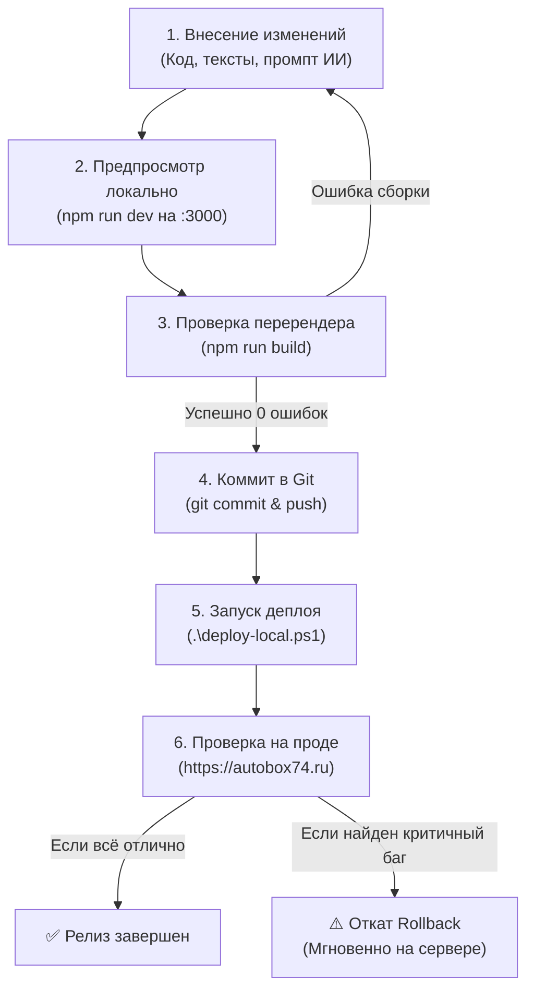

# 🚀 Руководство: Локальная сборка Docker-образа и деплой по SSH на слабый VPS (512MB – 1GB RAM)

Данное руководство предназначено для развертывания проекта **AutoBox74 (`autobox74.ru`)** на виртуальных серверах с минимальными характеристиками (**512 МБ – 1 ГБ RAM**, 1 vCPU, например, недорогие тарифы Beget, Timeweb, FirstVDS, Hetzner, Selectel).

---

## 💡 В чем суть проблемы и почему этот метод лучше?

При стандартном деплое на VPS команда `npm run build` или `docker compose up --build` компилирует Next.js непосредственно на сервере:
* Компиляция TypeScript, Turbopack/Webpack и оптимизация 16+ страниц требуют **от 1.5 до 2.5 ГБ оперативной памяти** в пике.
* На сервере с 512 МБ – 1 ГБ RAM процесс сборки падает с ошибкой ядра Linux: **`Out of Memory (OOM) Killed (exit code 137)`**, либо намертво подвешивает сервер на 15–20 минут.

### Сравнение подходов:

| Параметр | Сборка прямо на VPS (`docker build`) | Локальная сборка на ПК + передача по SSH |
| :--- | :--- | :--- |
| **Требуемая RAM на VPS** | 2–3 ГБ (иначе вылетает OOM Crash) | **Всего 50–90 МБ в рантайме!** |
| **Нагрузка на CPU сервера** | 100% в течение 5–10 минут | 0% (сервер не напрягается) |
| **Время обновления сайта** | 5–10 минут | **15–30 секунд** |
| **Риск падения боевого сайта** | Высокий (нехватка ресурсов при сборке) | **Нулевой** (перезапуск готового контейнера) |
| **Минимальная цена VPS** | От 600–1200 ₽/мес (2–4 ГБ RAM) | **От 150–250 ₽/мес (512 МБ – 1 ГБ RAM)** |

> [!TIP]
> При локальной сборке всю тяжелую работу выполняет ваш рабочий компьютер. На сервер отправляется только готовый сжатый образ весом ~120–140 МБ, содержащий скомпилированный Next.js Standalone-сервер. В рантайме он потребляет **всего ~45–65 МБ RAM**!

---

## ⚡ КРАТКИЙ ПОШАГОВЫЙ ПЛАН (Шпаргалка быстрого деплоя)

Если сервер уже первично настроен, всё обновление выполняется в 3 действия:

### Для Windows (PowerShell):
```powershell
# В корне проекта C:\Users\user\ProjectIT\autobox.ru
.\deploy-local.ps1 -Server "159.194.213.100" -User "deployer"
```

### Для Linux / macOS / Git Bash:
```bash
chmod +x deploy-local.sh
./deploy-local.sh 159.194.213.100 deployer
```

---

## 📖 ПОДРОБНОЕ ПОШАГОВОЕ РУКОВОДСТВО

---

### Шаг 1. Подготовка слабого сервера (Файл подкачки Swap и безопасность)

Даже при запуске готового образа обязательно настройте **файл подкачки (Swap)** на сервере. Это страховочная подушка безопасности на случай внезапного наплыва посетителей.

#### 1.1. Создание Swap-файла на 1–2 ГБ
Подключитесь к VPS по SSH под `root`:
```bash
ssh root@159.194.213.100
```

Выполните команды:
```bash
# Проверяем наличие swap (если пусто — создаем)
swapon --show

# Выделяем файл подкачки на 1 ГБ (или 2 ГБ при диске > 20 ГБ)
fallocate -l 1G /swapfile
chmod 600 /swapfile
mkswap /swapfile
swapon /swapfile

# Делаем swap постоянным после перезагрузок
echo '/swapfile none swap sw 0 0' >> /etc/fstab

# Оптимизируем swappiness (использовать swap только при острой нехватке RAM)
sysctl vm.swappiness=10
echo 'vm.swappiness=10' >> /etc/sysctl.conf
```

Проверьте результат:
```bash
free -h
# Строка Swap должна показывать: 1.0Gi (used: 0B)
```

#### 1.2. Создание пользователя `deployer` и установка Docker
Если Docker еще не установлен на сервере:
```bash
# Создание пользователя
adduser deployer
usermod -aG sudo deployer

# Установка Docker
curl -fsSL https://get.docker.com | sh
usermod -aG docker deployer

# Настройка фаервола
ufw allow 22/tcp && ufw allow 80/tcp && ufw allow 443/tcp && ufw enable
```

---

### Шаг 2. Подготовка файлов конфигурации на сервере

На удаленном сервере должны находиться **только** конфигурационные файлы Nginx, SSL-сертификаты и `.env.local`. Исходный код проекта (TypeScript, Node modules) на сервере **не нужен**!

Перейдите под пользователя `deployer`:
```bash
su - deployer
mkdir -p /home/deployer/autobox.ru/certbot/conf
mkdir -p /home/deployer/autobox.ru/certbot/www
mkdir -p /home/deployer/autobox.ru/nginx
cd /home/deployer/autobox.ru
```

#### 2.1. Конфигурация Nginx
Создайте на сервере файл `/home/deployer/autobox.ru/nginx/nginx.conf` (или скопируйте его с локального репозитория):
```bash
nano nginx/nginx.conf
```
*(Вставьте актуальный конфиг с редиректами и защитой rate limit из проекта).*

#### 2.2. Файл переменных окружения `.env.local`
Создайте на сервере `.env.local`:
```bash
nano .env.local
```
Заполните реальными ключами:
```ini
NODE_ENV=production
PORT=3000
HOSTNAME=0.0.0.0

# OpenRouter
OPENROUTER_API_KEY=sk-or-v1-ваш_ключ

# Supabase
NEXT_PUBLIC_SUPABASE_URL=https://ваш-проект.supabase.co
NEXT_PUBLIC_SUPABASE_ANON_KEY=ваш_ключ_anon
SUPABASE_SERVICE_ROLE_KEY=ваш_service_key

# Защита от спама и лимиты
CHAT_COOLDOWN_SECONDS=5
CHAT_MAX_MESSAGE_LENGTH=600
CHAT_DAILY_PAID_LIMIT=100
CHAT_PAID_SESSIONS_PER_DAY=2
CHAT_IP_MAX_REQUESTS_PER_MINUTE=6
CHAT_IP_MAX_REQUESTS_PER_HOUR=40
```

#### 2.3. Боевой Compose-файл для готовых образов (`docker-compose.prod.yml`)
Создайте на сервере файл `docker-compose.prod.yml`:
```bash
nano docker-compose.prod.yml
```

Содержимое файла:
```yaml
version: '3.8'

services:
  app:
    image: autobox74-app:latest
    restart: unless-stopped
    expose:
      - "3000"
    environment:
      - NODE_ENV=production
      - PORT=3000
      - HOSTNAME=0.0.0.0
    env_file:
      - .env.local
    networks:
      - app-network
    deploy:
      resources:
        limits:
          memory: 256M
          cpus: '1.0'
        reservations:
          memory: 64M

  nginx:
    image: nginx:alpine
    restart: unless-stopped
    ports:
      - "80:80"
      - "443:443"
    volumes:
      - ./nginx/nginx.conf:/etc/nginx/nginx.conf:ro
      - ./certbot/conf:/etc/letsencrypt:ro
      - ./certbot/www:/var/www/certbot:ro
    depends_on:
      - app
    networks:
      - app-network
    deploy:
      resources:
        limits:
          memory: 128M

  certbot:
    image: certbot/certbot
    restart: unless-stopped
    volumes:
      - ./certbot/conf:/etc/letsencrypt:rw
      - ./certbot/www:/var/www/certbot:rw
    entrypoint: "/bin/sh -c 'trap exit TERM; while :; do certbot renew; sleep 12h & wait $${!}; done;'"
    networks:
      - app-network
    deploy:
      resources:
        limits:
          memory: 64M

networks:
  app-network:
    driver: bridge
```

> [!NOTE]
> Обратите внимание: блок `build: .` здесь отсутствует. Указана директива `image: autobox74-app:latest`, поэтому Docker Compose мгновенно запустит готовый контейнер без попыток что-либо компилировать на сервере.

---

### Шаг 3. Первичный выпуск SSL-сертификата (Let's Encrypt)

Если сертификаты еще не были выпущены на сервере, выполните разовую команду:
```bash
docker run -it --rm -p 80:80 \
  -v "$(pwd)/certbot/conf:/etc/letsencrypt" \
  -v "$(pwd)/certbot/www:/var/www/certbot" \
  certbot/certbot certonly --standalone \
  -d autobox74.ru -d www.autobox74.ru \
  --email info@autobox74.ru \
  --agree-tos --no-eff-email
```

---

### Шаг 4. Локальная сборка Docker-образа (на вашем компьютере)

На вашем рабочем ПК откройте терминал (PowerShell или Git Bash) в директории проекта `C:\Users\user\ProjectIT\autobox.ru`.

#### 4.1. Сборка под платформу `linux/amd64`
> [!IMPORTANT]
> Даже если вы работаете на Windows или macOS (Apple Silicon M1/M2/M3), сервер работает на архитектуре **Linux x86_64 (`linux/amd64`)**. Параметр `--platform linux/amd64` гарантирует 100% совместимость бинарников!

Выполните команду сборки:
```bash
docker build --platform linux/amd64 -t autobox74-app:latest .
```

Проверьте получившийся образ:
```bash
docker images autobox74-app:latest
# Размер составит всего ~130-140 МБ благодаря Next.js Standalone
```

---

### Шаг 5. Передача образа на VPS через SSH

Выберите наиболее удобный для вас вариант передачи:

#### 🌟 Вариант А: Надежная передача через временный архив (Рекомендуется для Windows)
Этот способ работает стабильно в любом PowerShell без проблем с бинарными потоками:

1. **Экспортируем образ в файл архива на вашем ПК:**
   ```powershell
   docker save autobox74-app:latest -o autobox74-app.tar
   ```

2. **Копируем архив на сервер через SCP:**
   ```powershell
   scp autobox74-app.tar deployer@159.194.213.100:/home/deployer/autobox.ru/
   ```

3. **Загружаем образ в Docker на сервере и удаляем временный `.tar`:**
   ```powershell
   ssh deployer@159.194.213.100 "cd /home/deployer/autobox.ru && docker load -i autobox74-app.tar && rm autobox74-app.tar"
   ```

4. **Удаляем локальный `.tar` с вашего ПК:**
   ```powershell
   Remove-Item autobox74-app.tar
   ```

---

#### ⚡ Вариант Б: Прямой потоковый пайплайн в 1 строку (Без промежуточных файлов)
Если у вас Git Bash, WSL, Linux или macOS, передачу можно выполнить без создания файлов на диске:

```bash
docker save autobox74-app:latest | gzip -c | ssh deployer@159.194.213.100 "gunzip -c | docker load"
```
*Сжатый поток `gzip` передается через защищенный SSH-туннель и на лету загружается в `docker load`.*

---

#### 🌐 Вариант В: Через GitHub Packages (ghcr.io) или Docker Hub
Если вы хотите иметь версионирование и единый репозиторий образов:

1. **Локальный вход и отправка:**
   ```bash
   # Локально тегируем образ
   docker tag autobox74-app:latest ghcr.io/ВАШ_АККАУНТ_GITHUB/autobox74-app:latest
   docker push ghcr.io/ВАШ_АККАУНТ_GITHUB/autobox74-app:latest
   ```

2. **На сервере просто скачиваем:**
   ```bash
   docker pull ghcr.io/ВАШ_АККАУНТ_GITHUB/autobox74-app:latest
   docker tag ghcr.io/ВАШ_АККАУНТ_GITHUB/autobox74-app:latest autobox74-app:latest
   ```

---

### Шаг 6. Запуск и перезапуск контейнера на сервере

После того как образ загружен в Docker на сервере, примените его:

```bash
ssh deployer@159.194.213.100
cd /home/deployer/autobox.ru

# Запуск приложения в фоне
docker compose -f docker-compose.prod.yml up -d --no-deps app

# Мягкая перезагрузка Nginx
docker compose -f docker-compose.prod.yml exec nginx nginx -s reload

# Удаление старых безымянных образов для экономии диска
docker image prune -f
```

---

### Шаг 7. Проверка потребления ресурсов на сервере

Убедитесь, насколько легковесно работает приложение:

```bash
docker stats --no-stream
```

Вы увидите реальные показатели:
```text
CONTAINER ID   NAME                 CPU %     MEM USAGE / LIMIT     MEM %     NET I/O
1a2b3c4d5e6f   autobox-app-1        0.05%     52.4MiB / 256MiB      20.47%    1.2MB / 800KB
7g8h9i0j1k2l   autobox-nginx-1      0.01%     8.9MiB / 128MiB       6.95%     1.5MB / 1.1MB
3m4n5o6p7q8r   autobox-certbot-1    0.00%     4.1MiB / 64MiB        6.41%     0B / 0B
```

> **ИТОГ:** Все три контейнера суммарно потребляют **всего ~65–70 МБ оперативной памяти!**  
> Даже на самом дешевом сервере с 512 МБ памяти остается свободным более 75% ресурсов!

---

### Шаг 8. Автоматизация деплоя в 1 клик

В проекте уже созданы два готовых скрипта автоматизации.

#### Для Windows — [`deploy-local.ps1`](deploy-local.ps1):
Запуск из корня проекта:
```powershell
.\deploy-local.ps1
```
*Скрипт автоматически:*
1. Соберет образ под `linux/amd64`.
2. Экспортирует его в `.tar`.
3. Передаст по SCP на сервер `159.194.213.100`.
4. Загрузит образ в Docker на сервере.
5. Перезапустит контейнер `app` и Nginx без даунтайма.
6. Удалит временный архив с вашего компьютера.

#### Для Linux / macOS — [`deploy-local.sh`](deploy-local.sh):
```bash
chmod +x deploy-local.sh
./deploy-local.sh
```

---

## 🔄 РЕГЛАМЕНТ И ПЛАН: ВНЕСЕНИЕ ИЗМЕНЕНИЙ, ПЕРЕРЕНДЕР И ПОВТОРНЫЙ ДЕПЛОЙ

Когда вам требуется изменить текст на сайте, обновить цены, скорректировать промпт AI-консультанта, добавить акцию или поправить стили — следуйте данному строгому стандарту разработки и развертывания.



---

### Этап 1. Где и что менять (Шпаргалка структуры проекта)

| Что нужно изменить | В каком файле редактировать |
| :--- | :--- |
| **Системный промпт ИИ, роль мастера, адрес и цены консультанта** | [`src/config/ai.config.ts`](src/config/ai.config.ts) (`AI_SYSTEM_PROMPT`, `SALES_BOOKING_SCRIPT`) |
| **Список доступных моделей нейросетей OpenRouter** | [`src/config/ai.config.ts`](src/config/ai.config.ts) (`CONFIGURED_OPENROUTER_MODELS`) |
| **Лимиты антиспама и кулдаун чата** | `.env.local` и [`src/lib/rate-limit.ts`](src/lib/rate-limit.ts) |
| **Цены на услуги и прайс-лист на странице `/ceny`** | [`src/app/ceny/page.tsx`](src/app/ceny/page.tsx) |
| **Список и описание услуг на `/uslugi`** | [`src/app/uslugi/page.tsx`](src/app/uslugi/page.tsx) |
| **Главная страница (УТП, баннеры, преимущества)** | [`src/app/page.tsx`](src/app/page.tsx) |
| **Акции и спецпредложения на `/akcii`** | [`src/app/akcii/page.tsx`](src/app/akcii/page.tsx) |
| **Контакты, адрес, карта, реквизиты на `/kontakty`** | [`src/app/kontakty/page.tsx`](src/app/kontakty/page.tsx) |
| **Шапка сайта, меню навигации, телефон** | [`src/components/Header.tsx`](src/components/Header.tsx) |
| **Подвал сайта, ссылки, юр. информация** | [`src/components/Footer.tsx`](src/components/Footer.tsx) |
| **Политика конфиденциальности и договор оферты** | [`src/app/politika-konfidencialnosti/page.tsx`](src/app/politika-konfidencialnosti/page.tsx), [`src/app/oferta/page.tsx`](src/app/oferta/page.tsx) |
| **Общие стили, шрифты, цветовые переменные** | [`src/app/globals.css`](src/app/globals.css) |
| **Конфигурация Nginx, SSL, заголовки, редиректы** | [`nginx/nginx.conf`](nginx/nginx.conf) |

---

### Этап 2. Локальная проверка и тестирование (Dev & Build)

Перед сборкой Docker-образа обязательно проверьте результат на своём компьютере:

#### 2.1. Быстрый визуальный предпросмотр (Hot Reload)
```bash
npm run dev
```
Откройте в браузере: **`http://localhost:3000`**  
*Проверьте:*
* Отображение на широком экране (ПК).
* В панели разработчика (`F12` $\rightarrow$ кнопка мобильного режима `Ctrl+Shift+M`) отображение на смартфонах (iPhone, Android).
* Работу кнопок записи и отправку сообщений в AI-чат.

#### 2.2. Обязательная проверка производственного билда (Валидация типов и SSG)
Остановите dev-сервер (`Ctrl + C`) и запустите сборку:
```bash
npm run build
```

> [!IMPORTANT]
> Команда `npm run build` выполняет:
> 1. Полную валидацию типов TypeScript (`tsc`).
> 2. Компиляцию через Turbopack.
> 3. Статическую предгенерацию всех 16 страниц сайта (SSG).  
> **Если в коде допущена опечатка, сборка покажет файл и номер строки.** Исправьте её локально до начала деплоя!

---

### Этап 3. Сохранение изменений в системе контроля версий (Git)

Никогда не деплойте изменения без фиксации в репозитории:

```bash
# 1. Проверяем измененные файлы
git status

# 2. Смотрим точный diff внесенных правок
git diff

# 3. Индексируем и коммитим с осмысленным сообщением
git add .
git commit -m "feat(ai-prompt): обновить цены на замену стоек и свободные слоты"

# 4. Отправляем в удаленный репозиторий GitHub
git push origin main
```

---

### Этап 4. Сборка нового Docker-образа и деплой на сервер

Теперь запускаем автоматизированный скрипт доставки.

#### Вариант 1 (Windows PowerShell — в 1 команду):
```powershell
.\deploy-local.ps1
```

#### Вариант 2 (Linux / macOS / Git Bash — в 1 команду):
```bash
./deploy-local.sh
```

#### Что делает скрипт автоматически (под капотом):
1. **Создает резервную копию предыдущего образа на сервере:**  
   Помечает текущую версию на VPS тегом `autobox74-app:previous` (для возможности мгновенного отката за 5 секунд).
2. **Компилирует новый образ под платформу сервера:**  
   `docker build --platform linux/amd64 -t autobox74-app:latest .`
3. **Упаковывает и передает образ по защищенному каналу SSH/SCP:**  
   Без сохранения лишних файлов и без нагрузки на память VPS.
4. **Загружает образ на сервере и бесшовно обновляет контейнер:**  
   `docker compose -f docker-compose.prod.yml up -d --no-deps app`  
   *(Next.js перезапускается за 1-2 секунды, Nginx мягко перехватывает трафик без ошибки 502).*
5. **Очищает старые слои и временные файлы:**  
   Не засоряет диск вашего ПК и сервера.

---

### Этап 5. Проверка боевого сайта и сброс браузерного кэша

После завершения скрипта выполните финальную верификацию:

#### 1. Проверка ответа веб-сервера:
```bash
curl -I https://autobox74.ru
# Должен возвращаться статус: HTTP/2 200 (или HTTP/1.1 200 OK)
```

#### 2. Сброс кэша в браузере (Важно!):
Веб-сервер Nginx настроен на долговременное кэширование статических файлов (`_next/static`).  
Если вы открыли сайт и не видите обновленный дизайн или текст:
* **Нажмите жесткую перезагрузку страницы:**  
  * Windows/Linux: **`Ctrl + F5`** или **`Shift + F5`**  
  * macOS: **`Cmd + Shift + R`**  
* Либо откройте сайт в **режиме Инкогнито** (`Ctrl + Shift + N`).

#### 3. Просмотр боевых логов контейнера (при необходимости):
```bash
ssh deployer@159.194.213.100 "cd /home/deployer/autobox.ru && docker compose -f docker-compose.prod.yml logs --tail=40 -f app"
```

---

### Этап 6. План экстренного отката (Rollback Plan)

Если после выкатки на продакшн выяснилось, что в логике или верстке есть критическая ошибка, вы можете мгновенно вернуть предыдущую стабильную версию:

#### Способ 1. Мгновенный откат на сервере (за 5 секунд без пересборки):
Поскольку скрипт деплоя автоматически сохраняет предыдущую версию как `autobox74-app:previous`, выполните по SSH:
```bash
ssh deployer@159.194.213.100
cd /home/deployer/autobox.ru

# Возвращаем предыдущий образ
docker tag autobox74-app:previous autobox74-app:latest

# Перезапускаем контейнер
docker compose -f docker-compose.prod.yml up -d --no-deps app
docker compose -f docker-compose.prod.yml exec nginx nginx -s reload
```
Сайт вернется в стабильное состояние за 3 секунды!

#### Способ 2. Откат через Git:
```bash
# Отменяем последний коммит
git revert HEAD --no-edit
git push origin main

# Запускаем повторный деплой
.\deploy-local.ps1
```

---

---

## 🛠️ Частые вопросы и решение проблем (Troubleshooting)

### 1. Ошибка `exec /usr/local/bin/docker-entrypoint.sh: exec format error`
* **Причина:** Образ был собран под архитектуру вашего процессора (например, ARM64 на Apple Silicon или без указания платформы), а сервер работает на x86_64.
* **Решение:** Всегда указывайте флаг платформы:
  ```bash
  docker build --platform linux/amd64 -t autobox74-app:latest .
  ```

### 2. Ошибка `Permission denied (publickey)` при выполнении скрипта
* **Причина:** SSH-ключ не добавлен на сервер или не запущен `ssh-agent`.
* **Решение:** Скопируйте ваш публичный ключ на VPS:
  ```powershell
  type $env:USERPROFILE\.ssh\id_ed25519.pub | ssh deployer@159.194.213.100 "cat >> ~/.ssh/authorized_keys"
  ```

### 3. Ошибка `no space left on device` на VPS
* **Причина:** Накопились старые неиспользуемые Docker-образы от предыдущих сборок.
* **Решение:** Очистите неиспользуемые данные Docker:
  ```bash
  docker image prune -a -f
  docker system prune -f
  ```

### 4. Контейнер `app` падает с ошибкой базы данных
* **Причина:** На сервере отсутствует или некорректно заполнен файл `/home/deployer/autobox.ru/.env.local`.
* **Решение:** Проверьте логи контейнера:
  ```bash
  docker compose -f docker-compose.prod.yml logs --tail=50 app
  ```
  Убедитесь, что ключи `NEXT_PUBLIC_SUPABASE_URL` и `OPENROUTER_API_KEY` указаны без кавычек и лишних пробелов.
